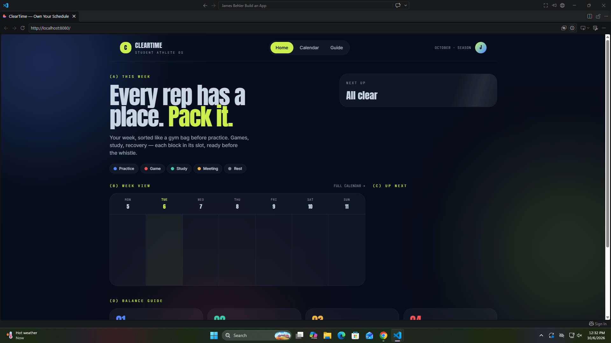

# App name

Gametime-Balance

## Who it's for

My app helps student-athletes manage their time because students should be able to balance sports and school.

## What it does

Gametime-Balance helps student athletes manage their time

## Built with

Lovable

## How to run it

```bash
npm install
npm run dev
```



## Update log

### Update 1
- **Feedback:** Nate wanted me to change some of the wording in the suggestions
- **What I changed:** Some of the wording of the suggestions made by the AI
- **Why:** So the suggestions are more user friendly

### Update 2
- **Feedback:** Kolby wanted to be able to add his events into the calendar
- **What I changed:** Gave the user the abillity to add events to the calender
- **Why:** Without this addition the app would be unusable

### Update 3
- **Feedback:** Adrian wanted to have the ability to remove events
- **What I changed:** I added the ability to remove events
- **Why:** If the user makes a mistake, they would be able to fix it now

## The update I made by hand

Nate wanting me to change some of the wording in the suggestions
